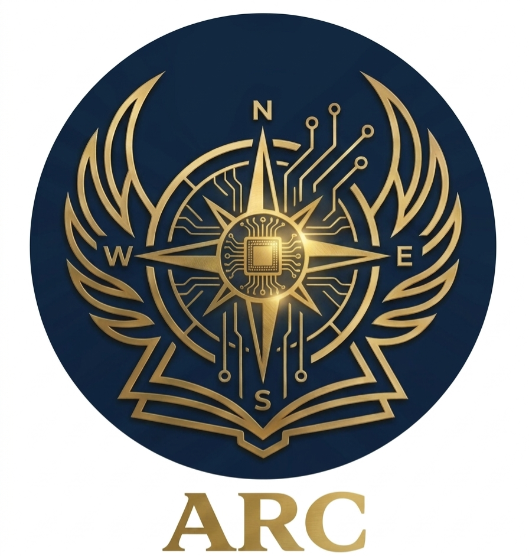

<div align="center">

  <!-- Main Hero Banner -->
  

  <br/><br/>

  <!-- Profile Logo & Title -->
  <a href="https://github.com/ARC838">
    
  </a>

  # ⚡ ARC | Ahmed Albana ⚡
  ### *Software Engineer & System Architect*

  <p align="center">
    <i>"Turning complex logic into robust architecture, guided by precision."</i>
  </p>

  <!-- Contact -->
  <p align="center">
    <a href="mailto:ahmedalie838.di@gmail.com">
      <b>📧 ahmedalie838.di@gmail.com</b>
    </a>
    &nbsp;•&nbsp;
    <b>📍 Ta'izz / Marib, Yemen 🇾🇪</b>
  </p>

</div>

---

## 🗡️ System Architecture (About Me)

<table width="100%">
<tr>
<td width="60%" valign="top">

```python
class ArcSystem:
    def __init__(self):
        self.developer = "Ahmed Albana (أحمد البنّا)"
        self.alias = "ARC"
        self.role = "Software Engineer & Certified ICDL Trainer"
        self.location = "Ta'izz / Marib, Yemen 🇾🇪"
        self.email = "ahmedalie838.di@gmail.com"
        
    def mission_statement(self):
        return "Crafting powerful systems, solving complex logic, and empowering upcoming developers."

    def domains(self):
        return [
            "Software Architecture & Problem Solving 🏛️",
            "Hardware & Electronics Diagnostics ⚙️",
            "Database Systems & AI Integration 🚀",
            "Technical Training & Mentorship 💻"
        ]
